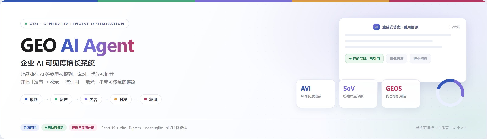
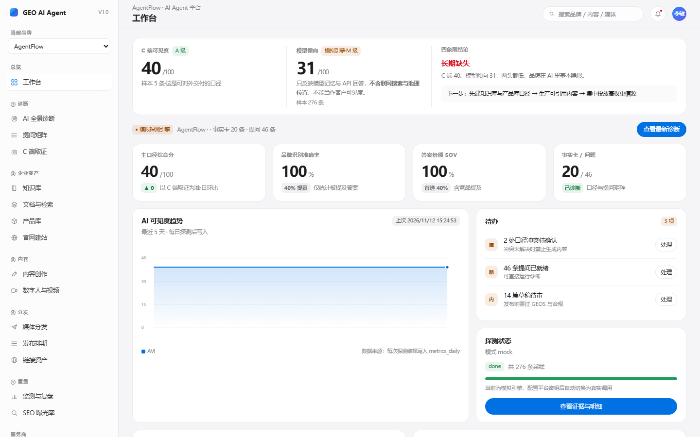
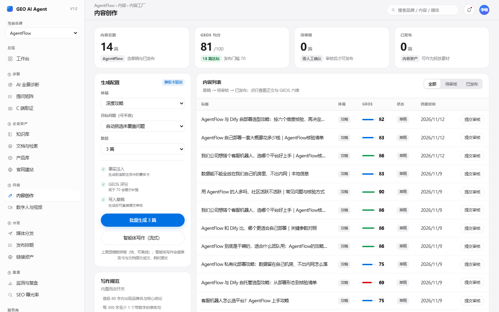
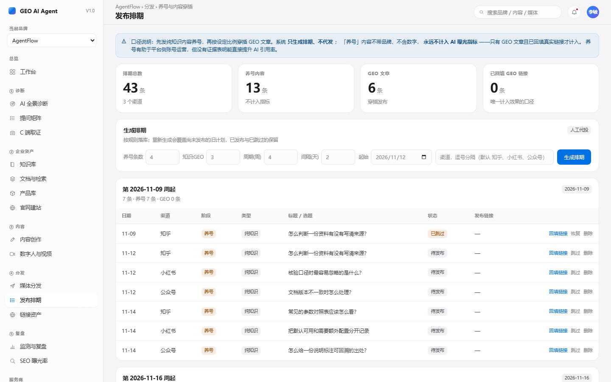
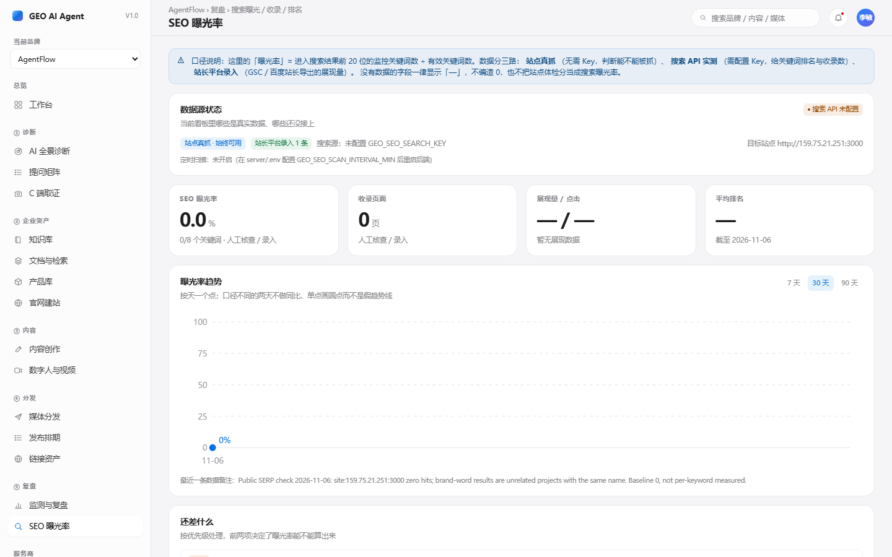
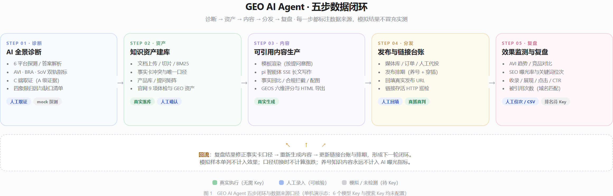
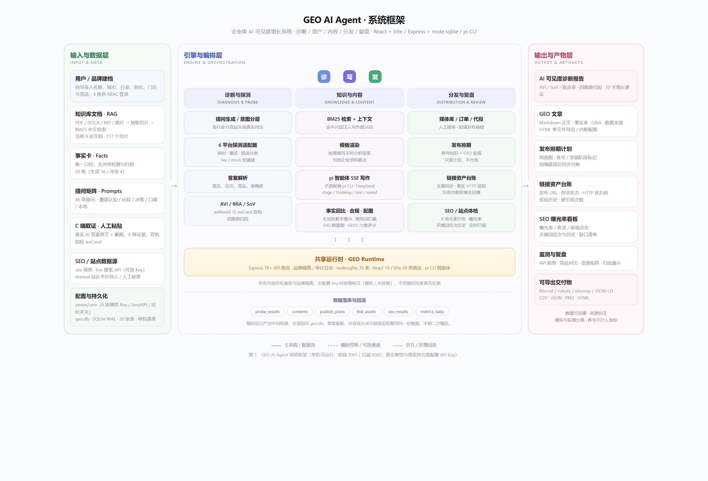

<div align="center">
  
</div>

# GEO AI Agent

<div align="center">

**Enterprise AI Visibility Platform** — get your brand mentioned, described accurately, and recommended first in AI-generated answers

<br />


<br /><br />

<a href="#quick-start">Quick Start</a> ·
<a href="#screenshots">Screenshots</a> ·
<a href="#architecture">Architecture</a> ·
<a href="#data-sources-and-integrity">Data Integrity</a> ·
<a href="#contact">Contact</a>

<br />

<a href="README.md">简体中文</a> · <strong>English</strong>

</div>

> Badges are static labels and do not represent CI status; `tests 25 passing` refers to a local `npm test` run. This project is a **single-machine, locally runnable demo**, not a production SaaS.

---

## Table of Contents

- [About](#about)
- [Why GEO](#why-geo)
- [Key Features](#key-features)
- [Quick Start](#quick-start)
- [Screenshots](#screenshots)
- [Architecture](#architecture)
- [Tech Stack](#tech-stack)
- [Data Sources and Integrity](#data-sources-and-integrity)
- [Configuration](#configuration)
- [Development Commands](#development-commands)
- [Roadmap](#roadmap)
- [Current Limitations](#current-limitations)
- [Docs and Deliverables](#docs-and-deliverables)
- [Contributing](#contributing)
- [Contact](#contact)
- [License](#license)

---

## About

GEO AI Agent turns the question "is our brand visible inside generative AI answers?" from a few random prompts into a **reproducible, verifiable, improvable** workflow:

```text
AI Diagnosis → Knowledge Assets → Content Production → Publishing and Scheduling → Monitoring
       ↑                                                          │
       └────────────── results feed back into the facts ────────────┘
```

Core metrics: AVI (AI Visibility Index), SoV (Share of Voice), GEOS (content citability score), AIW (AI Source Weight, currently seeded), and SEO exposure rate.

**The most important rule in this project**: every number carries its provenance, and simulated data is never presented as measured results. Capabilities without an API key are explicitly marked `simulated` or `not measured`; the system never fabricates rankings or AI answers.

---

## Why GEO

Information discovery is shifting from "keyword → search results → click a link" to "natural-language question → AI gives a conclusion plus a handful of sources". AI answers usually cite only 3–5 sources. A brand that is not cited gets **zero exposure**, not a low ranking.

For small and mid-sized businesses this creates three problems: **no visibility** (nobody knows how AI describes the brand), **inconsistent facts** (brand data is scattered and contradictory), and **no leverage** (no idea what to fix or whether a fix worked).

This system combines probing, a knowledge base, structured content, a source ledger, and review into one loop. It deliberately keeps manual evidence capture and manual data entry — **full automation is an optimization, verifiability is the requirement**.

---

## Key Features

- 🔍 **Dual-track AI visibility diagnosis**: six platform adapters with timeout, retry and error classification; `aviModel` and `aviCend` are computed separately with four-quadrant attribution, so model-side results never impersonate real consumer visibility
- 🧠 **Knowledge assets**: PDF / DOCX / MD / image upload with text extraction and chunking, BM25 retrieval for Chinese; fact cards include conflict detection and a single source of truth (keep one, archive the rest)
- ✍️ **Citable content production**: template rendering writes different analysis sections per question intent; the `pi` CLI agent streams long-form articles over SSE; every draft goes through fact verification, compliance blocking, SVG data figures and a six-dimension GEOS score
- 📤 **Publishing and scheduling**: media library, orders, ops-assisted manual placement, and a publishing schedule that mixes account warm-up posts with GEO articles — **plans only, no automated posting**
- 🔗 **Link asset ledger**: a single registry for published URLs, the official site, landing pages and cited links; real HTTP liveness checks, citation counts by domain, with simulated citations reported separately and excluded from results
- 📊 **SEO exposure dashboard**: nine real site-indexability checks, keyword positions, manual position entry, CSV import from Google Search Console / Baidu Webmaster Tools, and an optional scheduled scan
- 👥 **Engineering**: four-role RBAC, member invitations, audit logs, cascading brand deletion, 30 auto-migrated tables, `node:test` suites, and an end-to-end script

---

## Quick Start

### Prerequisites

| Item | Requirement |
| --- | --- |
| Node.js | ≥ 22 (dev environment: v25.7, uses built-in `node:sqlite`) |
| npm | ≥ 10 |
| Agent writing (optional) | local `pi` CLI, credentials in `~/.pi/agent/auth.json` |
| External services | none required; the database and demo data are created on first launch |

### Start in three lines

```bash
cd server && npm install && npm start                              # backend http://127.0.0.1:8002
cd prototype/react && npm install && npm run dev -- --port 3001    # frontend http://127.0.0.1:3001
curl http://127.0.0.1:8002/api/health                              # {"ok":true,"mode":"mock",...}
```

Open `http://127.0.0.1:3001`.

> **Port note**: `vite.config.ts` defaults to `3000` with `strictPort: true`. If `3000` is occupied, override with `-- --port 3001`; the `/api` proxy always targets `8002`. The backend listens on `127.0.0.1` only and can be changed with `PORT`.

### Demo accounts

| Role | Phone | Password |
| --- | --- | --- |
| Demo / owner | `13800000000` | `123456` |
| Operations (manual placement) | `13900000000` | `123456` |

`mode=mock` means no model API keys are configured and probing runs deterministic simulations — **this is expected, not a startup failure**.

### Stop

Terminate the two terminal processes, or use `Stop-Process -Id <backendPID>,<frontendPID>` on Windows PowerShell.

---

## Screenshots

Real runtime screenshots captured during the 2026-11-12 end-to-end test, unedited:

| Dashboard | Content studio |
| --- | --- |
|  |  |
| Dual-track AVI, four-quadrant attribution, to-dos | Article list, GEOS scores, template and agent writing |

| Publishing schedule | SEO exposure |
| --- | --- |
|  |  |
| Weekly view, phase labels, URL backfill | Exposure rate, keyword positions, manual entry and CSV import |

Two more screenshots (`/diagnosis` and `/links`) are in the same folder, six in total. The latest end-to-end run passed **25/25 steps**; see [`deliverables/e2e-agentflow/REPORT.md`](deliverables/e2e-agentflow/REPORT.md).

---

## Architecture

### Five-step loop and data provenance

Green means real execution without any key, blue means manually entered but verifiable data, gray means simulated or pending a key. Review results feed back into fact cards, content regeneration and the publishing schedule.



> Figure 1: six model keys and the search key are not configured, so "diagnosis" and "keyword ranking" remain simulated / not measured.

### System framework

Input and data layer → engine and orchestration layer → output and artifacts layer. Each block maps to an actual module in the codebase.



> Figure 2: brand / knowledge base / fact cards on the left; diagnosis, content and distribution pipelines plus the shared runtime in the middle; reports, articles, ledgers and dashboards on the right.

### Repository layout

```text
GEO Aiagent/
├── README.md                 Chinese README
├── README.en.md              This file
├── .gitignore                ignores node_modules / .env / *.db / uploads / screenshots
├── docs/
│   └── GEO-AI-Agent-PRD.md   Product and implementation spec (19 chapters)
├── server/                   Express + node:sqlite
│   ├── index.js              ~87 API routes and entry point
│   ├── db.js                 30 tables, migrations and seed data
│   ├── geo.js / probe.js / providers.js      AVI calculation / probing / credential modes
│   ├── seo.js / links.js / seo-import.js    SEO, link ledger, CSV parsing
│   ├── content-template.js / plan.js        article renderer / scheduling rules
│   ├── agent/                piagent SSE, fact check, compliance, figures, site audit
│   ├── scripts/              smoke scripts and e2e-agentflow.mjs
│   └── *.test.js             node:test (6 files / 25 cases)
├── prototype/react/          React 19 + Vite 7 + Tailwind 4 (21 pages)
└── deliverables/             banner, diagrams, screenshots, samples, E2E report
```

Three rules govern the publishing schedule: **plans only, no automated posting**; **warm-up posts never count toward AI visibility metrics**; only a GEO article with a real backfilled URL counts as a result.

---

## Tech Stack

| Layer | Technology | Notes |
| --- | --- | --- |
| Frontend | React 19 · React Router 7 · Vite 7 · Tailwind 4 · TypeScript 5 | 21 pages, 22 route declarations |
| Backend | Express 4 · Node.js ≥22 (`node:sqlite`) | ~87 APIs, listens on `127.0.0.1:8002` only |
| Data | SQLite (WAL) | 30 tables with automatic creation, migration and seeding |
| Agent | `pi` CLI (local DeepSeek) | child process + SSE stream, credentials independent of `server/.env` |
| Documents | `pdfjs-dist` · `mammoth` · `xlsx` · `jszip` · `sharp` · `cheerio` | extraction, chunking, BM25, image handling |
| Testing | `node:test` + Playwright headless browser | 25 cases plus key-page rendering checks |

---

## Data Sources and Integrity

| Channel | Current state | How to make it real |
| --- | --- | --- |
| AI probing (AVI / mention rate / SoV) | `mode=mock`, all six platforms simulated | configure at least one `GEO_*_KEY` |
| Agent writing / data structuring | **real execution** (local `pi` CLI) | credentials in `~/.pi/agent/auth.json`, **not read from `server/.env`** |
| Site indexability / SEO scan | **real HTTP fetches** (9 checks) | no key needed; target site currently 41/100 |
| Keyword ranking / `site:` coverage | `not measured` | add a SerpAPI key, or enter positions manually in `/seo` |
| Impressions / clicks / CTR / indexed pages | manual baseline or CSV import | export from GSC / Baidu Webmaster Tools and import |
| Consumer-side AI answer evidence | manually pasted, grade-A evidence | `/evidence`, more authoritative than raw model APIs |
| Link liveness | **real HTTP checks** | click "batch check" in `/links` |
| Published URLs | backfilled by operators | `/ops` → `/links` → schedule backfill |
| Media library / 90-day baseline / demo accounts | **seed / demo data** | replace with real business data before launch |

**Real data without any key is possible today**: check eight keyword positions manually → enter them in `/seo` → exposure rate and trend; import a weekly GSC CSV; capture AI answers in `/evidence`; backfill published URLs → `/links` liveness checks. Full automation only reduces "a few minutes per day" to zero; it is not a prerequisite.

All manually entered data is tagged `manual`; simulated citations are tracked separately as `citedMock` and excluded from results. When the data source changes, period-over-period deltas are not calculated, so a source switch is never mistaken for growth.

---

## Configuration

```bash
cp server/.env.example server/.env
# Windows PowerShell: Copy-Item server\.env.example server\.env
```

| Variable group | Purpose | Required |
| --- | --- | --- |
| Six `GEO_*_KEY` / `_BASE` / `_MODEL` groups | real probing across six model providers | at least one for real AVI |
| `GEO_SEO_SEARCH_KEY` + `GEO_SEO_SEARCH_BASE` + `GEO_SEO_SEARCH_ENGINE` | search results API (SerpAPI recommended) | required for real rankings |
| `GEO_SEO_SCAN_INTERVAL_MIN` | scheduled scan interval in minutes, `0` = off | optional |
| `GEO_TOKEN_SECRET` | login token signature | **must be replaced with a random secret before launch** |
| `PORT` / `GEO_DB_PATH` | listen port / database path | defaults `8002` / `./data/geo.db` |

Minimal verification set (one DeepSeek key + one SerpAPI key, then restart):

```text
GET  /api/health            → mode=live / mixed, providers.live > 0
POST /api/providers/test    → ok=true
GET  /api/seo/overview      → sources.serp.live=true
POST /api/seo/scan          → mode=live, real keyword positions appear
```

> **Note**: Bing Web Search v7 was retired on 2025-08-11 (the endpoint returns 410), so do not request that subscription key. For Doubao, `_MODEL` must be an inference endpoint ID (`ep-xxx`); Tencent Yuanbao is approximated with Hunyuan because its consumer app has no public API.
>
> Never paste keys into chat, frontend code or commits; `.env` is covered by `.gitignore`.

---

## Development Commands

| Directory | Command | Purpose |
| --- | --- | --- |
| `server` | `npm start` / `npm run dev` | start / start with hot reload |
| `server` | `npm test` | `node --test`, 25 cases |
| `server` | `node scripts/e2e-agentflow.mjs` | full end-to-end test (services must be running) |
| `prototype/react` | `npm run dev -- --port 3001` | dev server |
| `prototype/react` | `npx tsc --noEmit` | strict TypeScript check |
| `prototype/react` | `npm run build` | build into `dist/` |

The database is created on first launch. **Deleting `server/data/geo.db*` wipes all local data**, so back it up first. Deleting a brand automatically exports a bundle to `server/data/backups/`, but there is currently **no standalone restore endpoint**.

See sections **19.2 / 19.3** of `docs/GEO-AI-Agent-PRD.md` for the full table and API list.

---

## Roadmap

| Status | Items |
| --- | --- |
| ✅ Shipped | five-step loop, 30 tables / 87 APIs / 21 pages, dual-track metrics, KB RAG, two content pipelines, link ledger, publishing schedule, SEO dashboard, RBAC and audit log |
| 🟡 Semi-automated, zero key | manual position entry, webmaster CSV import, consumer-side evidence capture, operator URL backfill, manual link checks |
| 🔵 Needs keys or OAuth | real probing on six providers, SerpAPI rankings and coverage, GSC / Baidu OAuth, scheduled scans and link checks |
| 🟣 Planned (PRD V1.5 / V2.0) | competitor radar, real AIW, smart media selection, AI image / video, UTM attribution funnel, monthly PDF reports, billing, public API |
| ⚙️ Engineering | single-process static hosting of `dist`, CI / Docker, HTTPS / rate limiting, real secrets, backups, the ten launch acceptance checks in PRD 17.2 |

---

## Current Limitations

**The workflow runs end to end, but this is still a local demo**:

- Model and search keys are not configured, so AVI and keyword rankings remain simulated / not measured. The target site `159.75.21.251:3000` is a bare IP with an empty SPA shell and fake `robots/sitemap` responses; indexability is only 41/100 — **without fixing the site, adding keys merely measures "zero hits" more precisely**
- The backend listens on `127.0.0.1` only, does not serve the frontend `dist`, and requires two processes; no HTTPS, rate limiting, CI / Docker, object storage or backup policy
- `GEO_TOKEN_SECRET` is still the default, demo accounts are fixed, and CORS reflects any origin
- Video player, voice cloning, liveness verification, external video generation, report generation, batch re-testing, cross-tenant switching, UTM / lead attribution, alerting and direct media APIs are not integrated (buttons are labelled "not connected" or only register a `pending` task)
- The ten launch acceptance items in PRD 17.2 are still unchecked

---

## Docs and Deliverables

| Location | Content |
| --- | --- |
| `docs/GEO-AI-Agent-PRD.md` chapters 1–18 | positioning, metric dictionary, requirements, roadmap, visual spec |
| 19.1 / 19.2 / 19.3 | run instructions, 30 tables, full API list |
| 19.4 – 19.6 | probing engine, agent, boundaries and next steps |
| 19.7 / 19.8 | SEO exposure module, link asset ledger |
| 19.9 / 19.10 | semi-automated data channels, static page migration |
| 19.11 / 19.12 | content quality work, publishing schedule |
| `deliverables/e2e-agentflow/REPORT.md` | latest end-to-end results and screenshots |
| `LICENSE` · `NOTICE` · `THIRD_PARTY_NOTICES.md` | Apache-2.0 license text, attribution notice and dependency licenses |

### Images and regeneration

All diagrams and screenshots are self-drawn or captured from the running app; the badges at the top are static shields.io labels.

| Image | HTML source | Regenerate |
| --- | --- | --- |
| `deliverables/geo-ai-agent/banner.png` | `banner.html` | 1600×460 banner; screenshot the `.banner` element; available at `/geo-banner.html` under Vite |
| `deliverables/geo-ai-agent/pipeline.png` | `pipeline.html` | five-step loop; `/geo-pipeline.html` under Vite |
| `deliverables/geo-ai-agent/framework.png` | `framework.html` | system framework; `/geo-framework.html` under Vite |
| `deliverables/e2e-agentflow/screenshots/*.png` | — | re-capture six pages after running `node scripts/e2e-agentflow.mjs` |

A copy of each HTML source lives in `prototype/react/public/`. If the module structure changes, update the HTML and re-capture so the diagrams stay in sync with the code.

---

## Contributing

This repository currently focuses on the README and visual assets; source code will be published incrementally, after which `CONTRIBUTING.md` and CI will be added.

Until then, feedback and feature requests are welcome through [Issues](https://github.com/PHclaw/geo-ai-agent/issues). For local changes, please make sure `npm test`, `npx tsc --noEmit` and `npm run build` pass, and **never commit `.env`, `geo.db` or any secret**.

---

## Contact

For business cooperation, project inquiries or technical exchange:

**📮 2730545346@qq.com** · [Send an email](mailto:2730545346@qq.com)

You can also leave a message in [Issues](https://github.com/PHclaw/geo-ai-agent/issues).

---

## License

Released under the **Apache License 2.0**. The full text is in [`LICENSE`](LICENSE), attribution notices in [`NOTICE`](NOTICE), and dependency licenses in [`THIRD_PARTY_NOTICES.md`](THIRD_PARTY_NOTICES.md).

Commercial use, modification, redistribution and closed-source integration (including SaaS) are all permitted; the only requirement is keeping the copyright and license notices. Apache-2.0 also grants explicit patent rights with a patent-termination clause.

For commercial cooperation, custom delivery or white-label needs, get in touch via the address above.

---

<div align="center">

If this project is useful to you, a ⭐ Star is appreciated

📮 2730545346@qq.com

</div>
