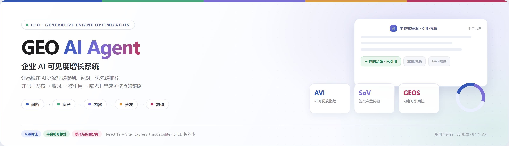
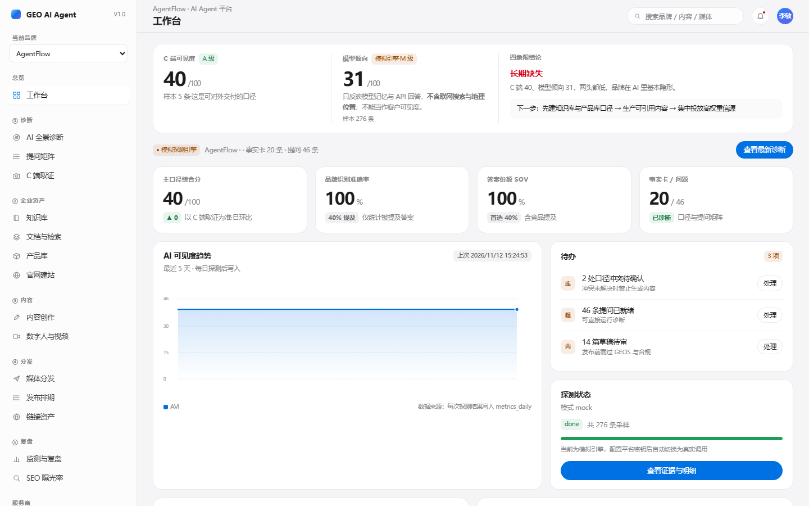
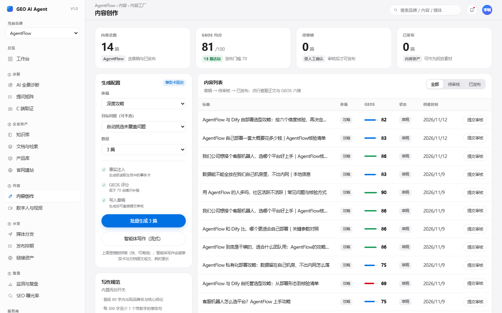
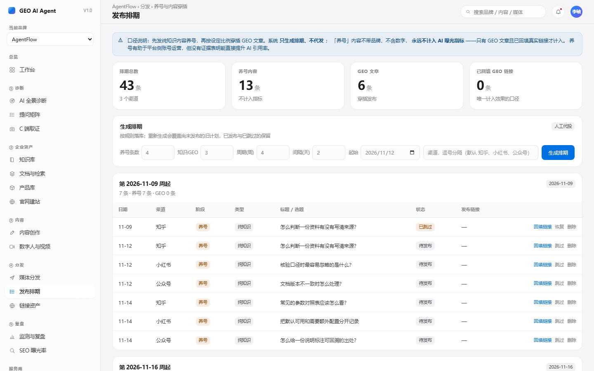
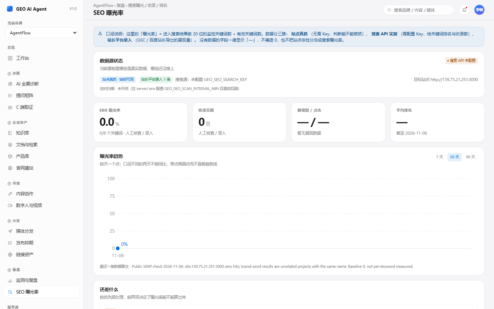
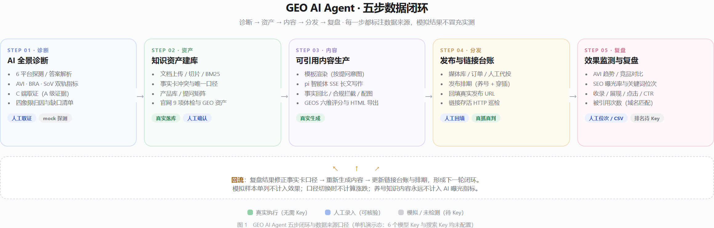
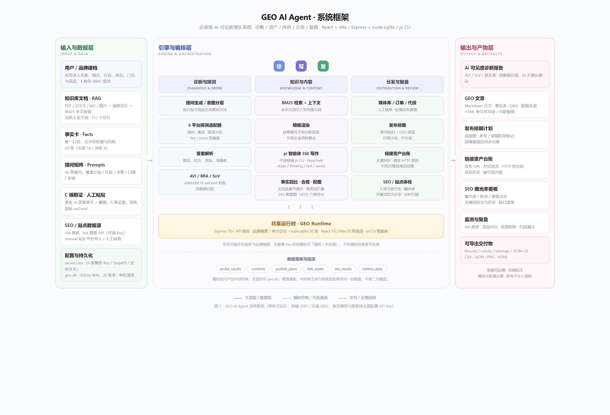

<div align="center">
  
</div>

# GEO AI Agent

<div align="center">

**企业 AI 可见度增长系统** — 让品牌在 AI 答案里被提到、说对、优先被推荐

<br />


<br /><br />

<a href="#快速开始">快速开始</a> ·
<a href="#效果展示">效果展示</a> ·
<a href="#系统架构">系统架构</a> ·
<a href="#数据源与口径">数据口径</a> ·
<a href="#合作联系">合作联系</a>

</div>

> 徽章为静态标识，不代表 CI 状态；`tests 25 passing` 指本地 `npm test` 结果。本项目是**本地可运行的单机演示版**，不是已上线的 SaaS。

---

## 目录

- [项目简介](#项目简介)
- [背景与动机](#背景与动机)
- [核心特性](#核心特性)
- [快速开始](#快速开始)
- [效果展示](#效果展示)
- [系统架构](#系统架构)
- [技术栈](#技术栈)
- [数据源与口径](#数据源与口径)
- [配置](#配置)
- [开发命令](#开发命令)
- [路线图](#路线图)
- [当前边界](#当前边界)
- [文档与交付物](#文档与交付物)
- [贡献](#贡献)
- [合作联系](#合作联系)
- [许可证](#许可证)

---

## 项目简介

GEO AI Agent 把「品牌在生成式 AI 里是否可见」这件事，从随机问几句变成一条**可复现、可核验、可改进**的链路：

```text
AI 全景诊断 → 知识资产建库 → 内容生产 → 分发与排期 → 监测复盘
        ↑                                            │
        └──────────── 结果回流修正口径 ────────────────┘
```

核心指标：AVI（AI 可见度指数）、SoV（答案声量份额）、GEOS（内容可引用性）、AIW（信源权重，当前为种子值）、SEO 曝光率。

**本项目最重要的一条口径**：来源标注、不把模拟数据当成真实结果。没配置 Key 的能力会明确显示「模拟 / 未检测」，不会编造排名或 AI 答案。

---

## 背景与动机

用户获取信息的路径正在从「关键词 → 搜索引擎 → 点开链接」迁移到「自然语言提问 → AI 直接给出结论 + 少量信源」。AI 答案通常只给 3–5 个信源，未进入答案的品牌获得的是 **0 曝光**，而不是排名靠后的低曝光。

对中小企业来说，这带来三个问题：**看不见**（不知道 AI 怎么描述自己）、**说不清**（品牌口径散落各处且互相矛盾）、**无抓手**（不知道该改什么、改完有没有效果）。

这套系统用「探测 + 知识库 + 结构化内容 + 信源台账 + 复盘」把这三者串起来，并且刻意保留人工取证与人工录入通道——**全自动不是能否使用的前提，可核验才是**。

---

## 核心特性

- 🔍 **双轨 AI 可见度诊断**：6 平台探测适配器（超时 / 重试 / 错误分类），`aviModel` 与 `aviCend` 各算各的，四象限归因，不把模型口径冒充客户真实可见度
- 🧠 **知识资产建库**：PDF / DOCX / MD / 图片上传后抽取切片，BM25 中文检索；事实卡带冲突检测与「保留一条 + 其余归档」的唯一口径
- ✍️ **可引用内容生产**：模板渲染按提问意图写不同分析段落，`pi` 智能体 SSE 流式长文写作；生成后自动做事实回比、合规拦截、SVG 数据图与 GEOS 六维评分
- 📤 **分发与排期**：媒体库 / 订单 / 人工代投、发布排期（养号知识内容 + GEO 文章穿插），**只生成计划、不代发**
- 🔗 **链接资产台账**：统一登记发布地址、官网、落地页与引用链接；真实 HTTP 存活巡检、按域名统计被引用次数，模拟引用单列不计入效果
- 📊 **SEO 曝光率看板**：站点 9 项可索引性真抓、关键词位次、人工逐词录入、站长平台 CSV 批量导入、定时扫描开关
- 👥 **工程能力**：4 角色 RBAC、成员邀请、审计日志、品牌级联清理、30 张表自动迁移、`node:test` 与全链路 E2E 脚本

---

## 快速开始

### 前置

| 项 | 要求 |
| --- | --- |
| Node.js | ≥ 22（开发环境 v25.7，使用内置 `node:sqlite`） |
| npm | ≥ 10 |
| 智能体写作（可选） | 本机 `pi` CLI，凭证在 `~/.pi/agent/auth.json` |
| 外部服务 | 不需要；首次启动自动建库并写入演示数据 |

### 三行启动

```bash
cd server && npm install && npm start                       # 后端 http://127.0.0.1:8002
cd prototype/react && npm install && npm run dev -- --port 3001   # 前端 http://127.0.0.1:3001
curl http://127.0.0.1:8002/api/health                       # {"ok":true,"mode":"mock",...}
```

打开 `http://127.0.0.1:3001`。

> **端口说明**：`vite.config.ts` 默认 `3000` 且 `strictPort: true`；`3000` 被占用时用 `-- --port 3001` 覆盖即可，`/api` 代理固定指向 `8002`。后端默认只监听 `127.0.0.1`，可用 `PORT` 覆盖。

### 演示账号

| 角色 | 账号 | 密码 |
| --- | --- | --- |
| 演示 / 负责人 | `13800000000` | `123456` |
| 运营（人工代投） | `13900000000` | `123456` |

`mode=mock` 表示没有真实模型 Key、探测走确定性模拟——**这是预期的，不是启动失败**。

### 停止

结束两个终端进程即可；后台启动时可用 `Stop-Process -Id <后端PID>,<前端PID>`（Windows PowerShell）。

---

## 效果展示

下面是真实运行时的页面截图（2026-11-12 全链路测试截取，未做修饰）：

| 工作台 | 内容创作 |
| --- | --- |
|  |  |
| AVI 双轨指标、四象限归因与待办 | 文章列表、GEOS 评分、模板与智能体写作 |

| 发布排期 | SEO 曝光率 |
| --- | --- |
|  |  |
| 周视图、养号 / 穿插阶段标记、回填链接 | 曝光率、关键词位次、人工录入与 CSV 导入 |

另外两张（`/diagnosis` 诊断、`/links` 链接资产台账）在同目录，共 6 张。最近一次端到端测试 **25/25 通过**，报告见 [`deliverables/e2e-agentflow/REPORT.md`](deliverables/e2e-agentflow/REPORT.md)。

---

## 系统架构

### 五步闭环与数据口径

绿色是无需 Key 的真实执行，蓝色是人工录入（可核验），灰色是模拟或待 Key 的通道；复盘结果会回流去修正事实卡口径、重新生成内容并更新发布排期。



> 图 1：当前 6 个模型 Key 与搜索 Key 均未配置，所以「诊断」与「关键词排名」仍标为模拟 / 未检测。

### 系统框架

输入与数据层 → 引擎与编排层 → 输出与产物层，三段式结构与代码里的模块一一对应。



> 图 2：左列是品牌 / 知识库 / 事实卡等输入，中间是诊断、内容、分发三条链路与共享运行时，右列是报告、文章、台账、看板等产物。

### 目录结构

```text
GEO Aiagent/
├── README.md                 本文件
├── .gitignore                忽略 node_modules / .env / *.db / 上传样本 / 验收截图
├── docs/
│   └── GEO-AI-Agent-PRD.md   产品需求与实现文档（19 章）
├── server/                   Express + node:sqlite
│   ├── index.js              约 87 个 API 与启动入口
│   ├── db.js                 30 张表、迁移与种子数据
│   ├── geo.js / probe.js / providers.js   AVI 计算 / 6 平台探测 / 凭证判定
│   ├── seo.js / links.js / seo-import.js  SEO、链接台账、CSV 解析
│   ├── content-template.js / plan.js      文章渲染 / 发布排期规则
│   ├── agent/                piagent SSE、事实回比、合规、数据图、站点体检
│   ├── scripts/              冒烟脚本与 e2e-agentflow.mjs
│   └── *.test.js             node:test（6 个文件 / 25 个用例）
├── prototype/react/          React 19 + Vite 7 + Tailwind 4（21 个页面）
└── deliverables/             交付物：横幅、框架图、闭环图、页面截图、生成样本、E2E 报告
```

发布排期遵循三条口径：**只生成计划、不代发**；**养号知识内容不计入 AI 曝光指标**；只有「GEO 文章 + 已回填真实链接」才计入效果。

---

## 技术栈

| 层 | 技术 | 说明 |
| --- | --- | --- |
| 前端 | React 19 · React Router 7 · Vite 7 · Tailwind 4 · TypeScript 5 | 21 个页面，22 条 Route 声明 |
| 后端 | Express 4 · Node.js ≥22（`node:sqlite`） | 约 87 个 API，仅监听 `127.0.0.1:8002` |
| 数据 | SQLite（WAL） | 30 张表，自动建表 / 迁移 / 种子 |
| 智能体 | `pi` CLI（本机 DeepSeek） | 子进程 + SSE 事件流，凭证独立于 `server/.env` |
| 文档处理 | `pdfjs-dist` · `mammoth` · `xlsx` · `jszip` · `sharp` · `cheerio` | 上传抽取、切片、BM25、图片处理 |
| 测试 | `node:test` + Playwright 无头浏览器 | 25 个用例 + 关键页面渲染验证 |

---

## 数据源与口径

| 通道 | 当前状态 | 如何变真实 |
| --- | --- | --- |
| AI 探测（AVI / 提及率 / SoV） | `mode=mock`，6 平台全部模拟 | 至少填 1 个 `GEO_*_KEY` |
| 智能体写作 / 资料整理 | **真实执行**（本机 `pi` CLI） | 凭证在 `~/.pi/agent/auth.json`，**不读 `server/.env`** |
| 站点可索引性 / SEO 扫描 | **真实 HTTP 抓取**（9 项检查） | 无需 Key；目标站当前 41/100 |
| 关键词排名 / `site:` 收录 | 「未检测」 | 填 SerpAPI Key；或用 `/seo` 人工录入逐词位次 |
| 展现量 / 点击 / CTR / 收录 | 人工核查基线或 CSV 导入 | GSC / 百度站长导出后录 `/seo` |
| C 端 AI 答案取证 | 人工粘贴，A 级证据 | `/evidence`，比裸模型 API 更权威 |
| 链接存活 | **真实 HTTP 巡检** | `/links` 手动点「批量巡检」 |
| 发布链接 | 人工代投回填 | `/ops` → `/links` → 排期回填 |
| 媒体库 / 90 天指标基线 / 演示账号 | **种子 / 演示数据** | 上线前替换为真实业务数据 |

**零 Key 也能跑出真实数据**：人工查位次 → `/seo` 录入 → 曝光率与趋势；每周导 GSC CSV → 导入；AI 平台取证 → `/evidence`；发布回填 → `/links` 巡检。全自动只是把「每天几分钟」变成「0 分钟」。

所有人工数据标 `manual`，模拟样本单列 `citedMock` 不计入效果；口径切换时不计算涨跌，避免把数据源变化当成真实增长。

---

## 配置

```bash
cp server/.env.example server/.env
# Windows PowerShell：Copy-Item server\.env.example server\.env
```

| 变量组 | 作用 | 必需？ |
| --- | --- | --- |
| `GEO_DEEPSEEK_KEY` 等 6 个 `_KEY` / `_BASE` / `_MODEL` | 6 家大模型真实探测 | 至少 1 个才让 AVI 变真实 |
| `GEO_SEO_SEARCH_KEY` + `GEO_SEO_SEARCH_BASE` + `GEO_SEO_SEARCH_ENGINE` | 搜索结果 API（推荐 SerpAPI） | SEO 排名变真实必需 |
| `GEO_SEO_SCAN_INTERVAL_MIN` | 定时扫描间隔（分钟），`0` = 关闭 | 可选 |
| `GEO_TOKEN_SECRET` | 登录 Token 签名 | **上线前必须改成随机长串** |
| `PORT` / `GEO_DB_PATH` | 监听端口 / 数据库路径 | 默认 `8002` / `./data/geo.db` |

最小可验证集（1 个 DeepSeek Key + 1 个 SerpAPI Key，重启后验收）：

```text
GET  /api/health            → mode=live / mixed，providers.live > 0
POST /api/providers/test    → ok=true
GET  /api/seo/overview      → sources.serp.live=true
POST /api/seo/scan          → mode=live，关键词表出现真实位次
```

> **注意**：Bing Web Search v7 已于 2025-08-11 退役（端点返回 410），不要再申请该订阅密钥；豆包的 `_MODEL` 要填推理接入点 ID（`ep-xxx`）；腾讯元宝用混元近似，C 端无公开 API。
>
> 不要把 Key 贴进聊天、前端或提交记录；`.env` 已在 `.gitignore` 中。

---

## 开发命令

| 目录 | 命令 | 说明 |
| --- | --- | --- |
| `server` | `npm start` / `npm run dev` | 启动 / 热重载 |
| `server` | `npm test` | `node --test`，25 个用例 |
| `server` | `node scripts/e2e-agentflow.mjs` | 全链路 E2E（需前后端已启动） |
| `prototype/react` | `npm run dev -- --port 3001` | 开发服务器 |
| `prototype/react` | `npx tsc --noEmit` | TypeScript 严格检查 |
| `prototype/react` | `npm run build` | 构建到 `dist/` |

数据库在首次启动时自动建表；**删除 `server/data/geo.db*` 会清空所有本地数据**，请先备份。删除品牌时后端会自动整包导出到 `server/data/backups/`，但当前**没有独立恢复接口**。

API 分组与 30 张表清单见 `docs/GEO-AI-Agent-PRD.md` 的 **19.2 / 19.3**。

---

## 路线图

| 状态 | 内容 |
| --- | --- |
| ✅ 已落地 | 五步闭环、30 张表 / 87 API / 21 页面、双轨指标、KB RAG、两条内容生成通道、链接台账、发布排期、SEO 看板、RBAC 与审计 |
| 🟡 半自动可用（零 Key） | 人工逐词位次录入、站长平台 CSV 导入、C 端取证、人工代投回填、手动链接巡检 |
| 🔵 待接入（需 Key / 授权） | 6 家真实模型探测、SerpAPI 排名与收录、GSC / 百度站长 OAuth、定时扫描、定时巡检 |
| 🟣 规划中（PRD V1.5 / V2.0） | 竞品雷达、真实 AIW、智能选媒、AI 图片 / 视频、UTM 归因漏斗、月报 PDF、支付账单、开放 API |
| ⚙️ 工程化 | 一个进程托管 `dist`、CI / Docker、HTTPS / 限流、正式密钥、备份策略、17.2 上线验收十项 |

---

## 当前边界

**功能已跑通，但仍是本地演示态**：

- 未配模型 Key 与搜索 Key，AVI 与关键词排名还是模拟 / 未检测；目标站点 `159.75.21.251:3000` 是裸 IP + SPA 空白页，`robots/sitemap` 假 200，可索引性只有 41/100——**站点不修好，配齐 Key 也只是把「0 命中」测得更准**
- 后端只监听 `127.0.0.1`，不托管前端 `dist`，需要两个进程；无 HTTPS、限流、CI / Docker、对象存储与备份策略
- `GEO_TOKEN_SECRET` 仍是默认值，演示账号固定；CORS 回显任意 Origin
- 视频播放器、语音克隆、活体校验、外部视频生成服务、报告生成、批量复测、跨租户切换、UTM / 线索归因、告警、直连媒体 API 均未接入（相关按钮会标注「未接入」或只登记 `pending` 任务）
- PRD 17.2 的 10 项上线验收清单尚未勾选

---

## 文档与交付物

| 位置 | 内容 |
| --- | --- |
| `docs/GEO-AI-Agent-PRD.md` 1–18 章 | 产品定位、指标字典、功能需求、路线图、视觉规范 |
| 19.1 / 19.2 / 19.3 | 运行方式、30 张表、完整 API 清单 |
| 19.4 – 19.6 | 探测引擎、智能体、边界与后续 |
| 19.7 / 19.8 | SEO 曝光率模块、链接资产台账 |
| 19.9 / 19.10 | 半自动数据通道、静态页面改造 |
| 19.11 / 19.12 | 内容生成质量优化、发布排期 |
| `deliverables/e2e-agentflow/REPORT.md` | 最近一次全链路测试结果与页面截图 |

### 图片清单与重新生成

正文里的示意图与截图均为本项目自绘或实际运行截取；顶部徽章是 shields.io 静态标识。

| 图片 | HTML 源文件 | 重新生成方式 |
| --- | --- | --- |
| `deliverables/geo-ai-agent/banner.png` | `banner.html` | 项目横幅（1600×460），编辑 HTML 后截取 `.banner` 元素；Vite 运行时访问 `/geo-banner.html` |
| `deliverables/geo-ai-agent/pipeline.png` | `pipeline.html` | 五步闭环图；Vite 运行时访问 `/geo-pipeline.html` |
| `deliverables/geo-ai-agent/framework.png` | `framework.html` | 系统框架图；Vite 运行时访问 `/geo-framework.html` |
| `deliverables/e2e-agentflow/screenshots/*.png` | — | 跑 `node scripts/e2e-agentflow.mjs` 后由无头浏览器重截 6 个页面 |

三张自绘图在 `prototype/react/public/` 下各有一份同源副本；修改模块结构后请同步更新 HTML 再重新截图，避免图与代码漂移。

---

## 贡献

当前仓库以 README 与图示资源为主，源代码将逐步上传；上传完成后会补充 `CONTRIBUTING.md` 与 CI 流程。

在此之前，欢迎通过 [Issues](https://github.com/PHclaw/geo-ai-agent/issues) 反馈问题或提出需求。本地改动请至少跑通 `npm test`、`npx tsc --noEmit`、`npm run build`，并且**不要提交 `.env`、`geo.db` 或任何密钥**。

---

## 合作联系

商务合作、项目咨询、技术交流，欢迎邮件联系：

**📮 2730545346@qq.com** · [发送邮件](mailto:2730545346@qq.com)

也可以在 [Issues](https://github.com/PHclaw/geo-ai-agent/issues) 留言，我会尽快回复。

---

## 许可证

本项目目前为内部研发 / 演示工程，**尚未声明开源协议**。如需以特定协议（MIT / Apache-2.0 等）公开、二次使用或商业合作，请先通过上方邮箱联系确认。

---

<div align="center">

如果这个项目对你有启发，欢迎点个 ⭐ Star 支持一下

📮 2730545346@qq.com

</div>
